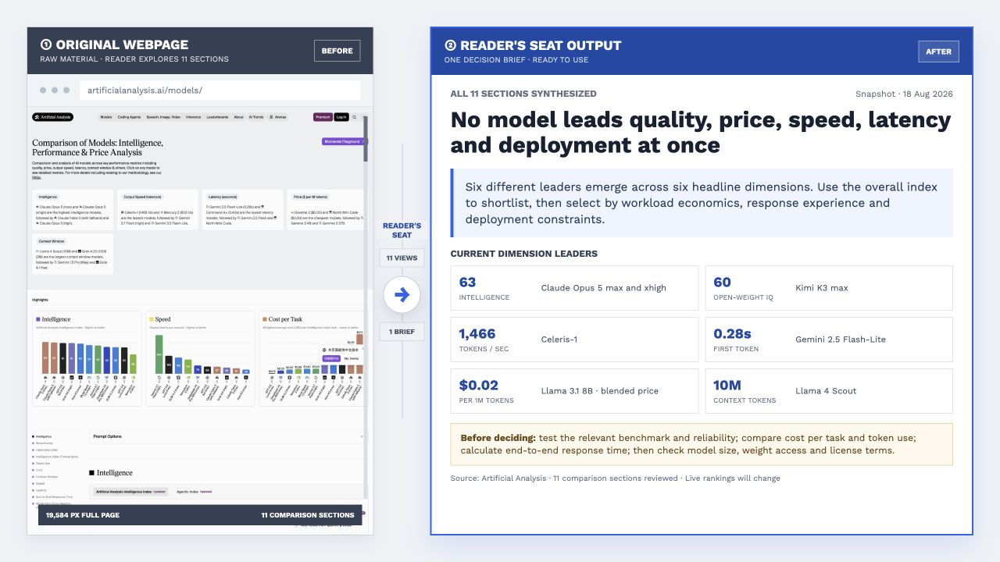

# Reader's Seat

> Turn scattered source material into complete documents readers can understand, verify, and act on.

[中文说明](README.zh-CN.md) · [Prompt examples](examples/quick-start.en.md) · [Install](#install)

[](SKILL.md)
[](LICENSE)
[](https://github.com/BobbyYue/reader-seat/actions/workflows/validate.yml)

Information-rich sources can still leave the reader to reconstruct the point: which result matters, what supports it, and what decision follows. Reader's Seat turns that material into a complete document with the conclusion, evidence, limits, and next step visible, without inventing missing facts.

<p align="center"><strong>① Original webpage on the left → ② Reader's Seat output on the right</strong></p>



<sub>The left panel uses a real continuous screenshot excerpt from the live [Artificial Analysis model comparison](https://artificialanalysis.ai/models/); the right panel synthesizes all 11 comparison sections. The preview is a dated snapshot and rankings will change.</sub>

## Install

### Ask Your Agent

Send this instruction to an agent that can install skills:

```text
Install Reader's Seat from https://github.com/BobbyYue/reader-seat.
Use the skill installer supported by this agent, keep the folder name reader-seat,
then confirm that SKILL.md can be loaded. Do not overwrite an existing installation without asking.
```

### Clone Manually

Clone the repository into the skill directory used by your agent:

```bash
git clone https://github.com/BobbyYue/reader-seat.git /path/to/your-agent/skills/reader-seat
```

Then start a new agent session or ask the agent to load `reader-seat/SKILL.md` explicitly. Skill discovery differs between agents.

## What You Can Make

| Start with | Get a complete document |
| --- | --- |
| Weekly reports, milestones, meeting notes, issue lists | **Project status brief** with the current conclusion, progress, blockers, decisions, and next steps |
| Metric definitions, query results, charts, methodology notes | **Analysis report** with the finding and magnitude, supporting evidence, data limits, alternative explanations, and next validation |
| Requirements, constraints, candidate architectures, benchmarks | **Technical decision document** with the decision, option comparison, trade-offs, implementation impact, rollback, and unresolved risks |

It also supports news and industry briefs, product documents, retrospectives, performance summaries, SOPs, runbooks, and help articles.

## Use It

Name the material, reader, and job the document must do. For example:

```text
Use Reader's Seat to turn these weekly reports, milestone plan, meeting notes,
and issue list into a complete project status report for the leadership team.
Make the current conclusion, schedule risk, supporting evidence, decisions needed,
and next steps easy to find. Preserve unknowns instead of filling them in.
```

See [ready-to-use prompts](examples/quick-start.en.md) for project progress, data analysis, and technical route documents.

## What It Protects

- **Meaning:** facts, quantities, definitions, ownership, commitments, and uncertainty remain intact.
- **Judgment:** conclusions stay connected to evidence, scope, and credible alternatives.
- **Reader effort:** task-critical information must be accessible, findable, understandable, and usable; titles, structure, and visuals support that path instead of adding decoration.
- **Concrete expression:** value-bearing titles, headings, and leads name the actual object and supported result instead of hiding value behind method labels or generic claims.
- **Complete opening:** defines what this reader must know, then checks whether a reader given only the selected opening or headings can recover those answers. Known omissions require repair; facts absent from the source remain unknown.
- **Independent review:** finished documents must pass four isolated checks for missing context, readability, source reliability, and structural or visual barriers.
- **Output fit:** the default is self-contained HTML in the source material's dominant language, unless another format or language is requested.
- **Delivery boundary:** language, format, and publication permission are locked before drafting; failed or missing verification blocks delivery.

Reader's Seat does not publish, overwrite, or send content without explicit authorization. It is intended for substantive documents rather than short-message polishing or unsupported content expansion.

### Upgrading to 0.25.0

Reviews now need specific passages and evidence showing why wording, content selection, and layout help the reader. Missing, outdated, or unresolved records cannot authorize delivery. Regenerate affected reviews after upgrading; clear originals and necessary caveats should stay intact.

Artifact initialization now requires a source-backed reader-answer plan. Older review records without the required-answer evidence must be regenerated before they can authorize verified delivery. A narrowly scoped native text patch also needs post-write readback and layout inspection; pre-write approval alone is not completion. See the [release notes](CHANGELOG.md) and [required-answer workflow](references/required-reader-answers.md).

Version 0.24.1 adds contextual expression review: locate the passage, explain its reader impact, and make the smallest meaning-preserving edit. Clear professional language stays unchanged; reviewer taste alone cannot trigger another round. This reuses the existing reviewers and retry limits.

<details>
<summary><strong>Repository structure, validation, and licenses</strong></summary>

| Folder | Function |
| --- | --- |
| `.github/` | Runs repository checks on every push and pull request. |
| `agents/` | Helps supported agent hosts recognize and present Reader's Seat. |
| `assets/` | Provides the self-contained HTML template, local fonts, and chart and diagram runtimes. |
| `config/` | Defines document scenarios, module-loading profiles, agent adapters, and the enforceable skill contract. |
| `evals/` | Provides frozen trigger, behavior, and cross-agent cases with judging criteria. |
| `examples/` | Contains prompts users can adapt to common document tasks. |
| `references/` | Provides detailed rules selected for each scenario, format, title, evidence, and visual need. |
| `scripts/` | Validates the skill, selects modules, creates HTML report scaffolds, and runs evaluations. |
| `tests/` | Verifies language, format, authorization, source integrity, and delivery-receipt enforcement. |

Validate an installation:

```bash
python3 /path/to/reader-seat/scripts/validate_skill.py
```

Update an installation:

```bash
git -C /path/to/reader-seat pull
```

Third-party font and visualization licenses are listed in [Third-Party Notices](assets/html/THIRD_PARTY_NOTICES.md).

</details>
