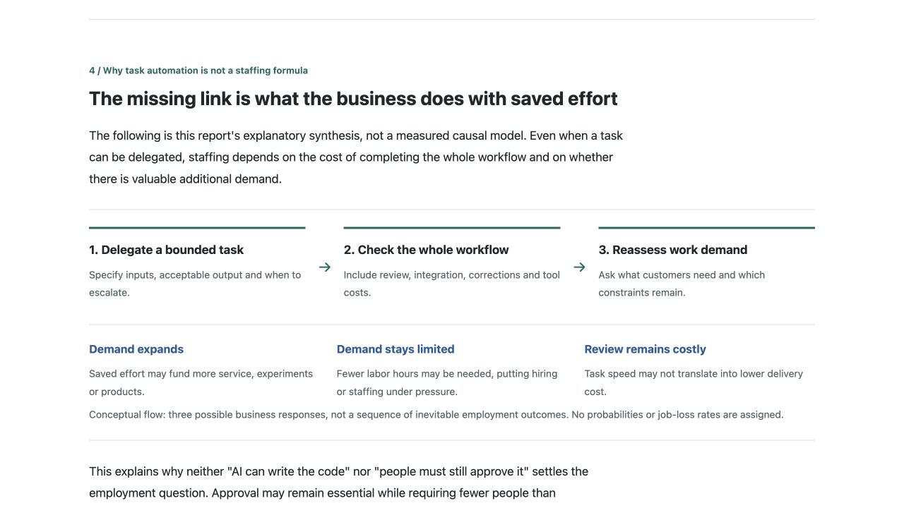

# Reader's Seat

> Write complete documents readers can understand, starting from a question or existing material.

[中文说明](README.zh-CN.md) · [Read the example report](https://bobbyyue.github.io/reader-seat/reports/ai-and-work.en.html) · [Install](#install)

[](SKILL.md)
[](LICENSE)
[](https://github.com/BobbyYue/reader-seat/actions/workflows/validate.yml)

An AI answer can be long, fluent, and still leave you asking: what is the conclusion, what supports it, and what does it mean for me? Reader's Seat organizes a complete document around those reader questions. It can research and write from a prompt, or restructure material you already have, without filling evidence gaps with invented facts.

## Example: how will AI affect jobs at internet companies?

You work in engineering, product, data, or operations. You keep seeing claims about AI replacing jobs, but need to distinguish changes already observed from forecasts before deciding what to learn or change at work.

**Input: a research question, not a finished article.**

```text
Will advances in AI replace human work? How are existing jobs being affected,
especially roles at internet companies? Cover changes already taking place
and possible long-term changes. Based on current authoritative research and
surveys, use Reader's Seat to produce a research report.
Write in English and output HTML.
```

**Output: a complete, source-linked report.**

The screenshot shows one of three evidence charts in the report. Each keeps the measured quantity and source beside the numbers. Open the report for hiring changes, task-time evidence, job projections, and implications for six familiar roles.

<a href="https://bobbyyue.github.io/reader-seat/reports/ai-and-work.en.html"></a>

**[Open the English report →](https://bobbyyue.github.io/reader-seat/reports/ai-and-work.en.html)** · [HTML file](docs/reports/ai-and-work.en.html) · [Chinese report](https://bobbyyue.github.io/reader-seat/reports/ai-and-work.zh.html)

The report gives the reader three things:

- **Evidence you can inspect:** three charts show hiring composition, a task-time estimate with its uncertainty, and a global jobs projection. Their different measures stay separate.
- **A concrete view of familiar work:** task-level implications for engineering, data analysis, product, design and content, operations and marketing, and customer support.
- **A usable outlook:** observed changes are separated from long-term scenarios, with sources and practical questions to investigate in your own work.

<sub>Drafted with Reader's Seat 0.36 and revised with user feedback; visual edition updated on 23 October 2026, using nine primary sources checked on 22 October. Role mappings are the report's synthesis. This is an edited example, with a full-review limitation documented in the [generation and review notes](docs/reports/example-notes.md#english).</sub>

## Install

### Ask Your Agent

Send this instruction to an agent that can install skills:

```text
Install Reader's Seat from https://github.com/BobbyYue/reader-seat.
Use the skill installer supported by this agent, keep the folder name reader-seat,
then confirm that this agent can load the skill, run its Python checks, and
support its isolated review workflow. Report missing support rather than
claiming full verification. Do not overwrite an existing installation without asking.
```

### Clone Manually

Clone the repository into the skill directory used by your agent:

```bash
git clone https://github.com/BobbyYue/reader-seat.git /path/to/your-agent/skills/reader-seat
```

Then start a new agent session or ask the agent to load `reader-seat/SKILL.md` explicitly. Skill discovery differs between agents.

Full checked delivery also needs a compatible review-capture integration. Loading the instructions alone does not connect that integration; see [host requirements](references/writing-execution.md).

## What You Can Make

| Start with | Get a complete document |
| --- | --- |
| A question, intended reader, and access to reliable sources | **Research report** that explains the evidence, competing interpretations, uncertainty, and implications |
| Weekly reports, milestones, meeting notes, issue lists | **Project status brief** with the current conclusion, progress, blockers, decisions, and next steps |
| Metric definitions, query results, charts, methodology notes | **Analysis report** with the finding and magnitude, supporting evidence, data limits, alternative explanations, and next validation |
| Requirements, constraints, candidate architectures, benchmarks | **Technical decision document** with the decision, option comparison, trade-offs, implementation impact, rollback, and unresolved risks |

It also supports news and industry briefs, product documents, retrospectives, performance summaries, SOPs, runbooks, and help articles.

## Use It

Name the material, reader, and job the document must do. For example:

```text
Use Reader's Seat to turn these weekly reports, milestone plan, meeting notes,
and issue list into a complete project status report for the leadership team.
Make the current conclusion, schedule risk, supporting evidence, decisions needed,
and next steps easy to find. Preserve unknowns instead of filling them in.
```

See [ready-to-use prompts](examples/quick-start.en.md) for project progress, data analysis, and technical route documents.

## What It Protects

- **Meaning:** facts, quantities, definitions, ownership, commitments, and uncertainty remain intact.
- **Judgment:** conclusions stay connected to evidence, scope, and credible alternatives.
- **Reader effort:** task-critical information must be accessible, findable, understandable, and usable; titles, structure, and visuals support that path instead of adding decoration.
- **Concrete expression:** value-bearing titles, headings, and leads name the actual object and supported result instead of hiding value behind method labels or generic claims.
- **Complete opening:** defines what this reader must know, then checks whether a reader given only the selected opening or headings can recover those answers. Known omissions require repair; facts absent from the source remain unknown.
- **Enough explanation:** a summary retains the reasons, evidence, and connections needed to understand the main views. A list of accurate headings is not a substitute; explicitly requested outlines stay brief.
- **Independent review:** finished documents must pass four isolated checks for missing context, readability, source reliability, and structural or visual barriers.
- **Output fit:** the default is self-contained HTML in the source material's dominant language, unless another format or language is requested.
- **Delivery boundary:** language, format, and publication permission are locked before drafting; failed or missing verification blocks delivery.

Reader's Seat does not publish, overwrite, or send content without explicit authorization. It is intended for substantive documents, including research from a question, rather than short-message polishing or unsupported content expansion.

<details>
<summary><strong>What's new in 0.36.0 and earlier upgrade notes</strong></summary>

### Clearer Expression Before, During And After Writing

Version 0.36.0 checks whether the document gives its answer directly, whether a clearer alternative preserves the meaning, and whether repeated corrections make the whole article harder to read. These checks run in the writing plan, each completed draft unit, and the independent readability review. Necessary warnings and negative findings stay when they help the reader. See [direct expression](references/direct-expression.md).

When upgrading, regenerate affected plans and review records: the new expression fields and reader-value version 5 are required. The 0.35.1 source-identity and reviewer-format fixes remain included. Current limitations include incomplete blind-replay coverage and a third-round draft fallback that can reject unresolved semantic checks; see the [release limitations](CHANGELOG.md#known-limitations). The report examples above remain from the previously published workflow.

### Current workflow

Version 0.34.0 binds writing stages, actual isolated review returns, and final delivery to the same document version. It also checks whether context adds reader value and whether claims are attributed to the right source. The integration rejects missing or stale evidence; it does not guarantee semantic correctness or install a host-wide enforcement hook. See the [changelog](CHANGELOG.md), [writing lifecycle](references/writing-lifecycle.md), and [managed execution](references/writing-execution.md).

Version 0.35 adds compact review records, reuse of unchanged computed measurements, and dependency-aware review scheduling. Version 0.35.1 also fixes a source-identity mismatch discovered while preparing this example: optional language metadata no longer blocks an unchanged source; changed source contents and paths remain blocked.

### Upgrading to 0.30.0

Choose the evidence, limits and unanswered questions before polishing prose. Existing reviews now explain a concrete reader benefit from each necessary edit, or why the original works. Complete [passage examples](references/writing-composition-examples.md) and [contextual writing cases](references/writing-craft-cases.md) are loaded only when a decision remains unclear. They are teaching material, not facts to copy into a document. Version 2 review fields, reviewers and retry limits remain unchanged; there is no new style score or extra review round.

Use the new [checked-delivery entrypoint](references/checked-delivery.md) for normal final delivery. It reruns the existing verifier, rejects missing or stale evidence, and returns the exact checked bytes. The third-round fallback remains an explicitly incomplete draft. Use `--output` to keep encoded document data out of model context. This local path does not install host enforcement or replace native-text-patch and live-publishing verification; passing program tests does not certify every writing judgment.

### Earlier workflow changes

Summaries now distinguish scanning the topics from understanding the argument. Before drafting, the reader-answer plan records the needed depth; source review then checks what an independent reader actually understood. There is no minimum word count, compulsory example quota, or extra review round. See the [overcompression example](references/badcases/overcompressed-summary.md).

Regenerate artifact plans with `depth` and answer `kind` fields, and reviews with source-anchored `depth_fit` evidence. Existing standalone answer locks remain readable; they do not replace the updated artifact workflow.

Reviews now check whether details are supported, passages advance understanding, and sentences are easy to follow without changing the writer's voice. Existing reviewers record specific passages; no extra review round or banned-phrase list is added. Regenerate older reviews for the version 2 evidence format. Clear originals, useful examples and decisive caveats stay intact. See the [writing examples](references/writing-craft.md).

Artifact initialization now requires a source-backed reader-answer plan. Older review records without the required-answer evidence must be regenerated before they can authorize verified delivery. A narrowly scoped native text patch also needs post-write readback and layout inspection; pre-write approval alone is not completion. See the [release notes](CHANGELOG.md) and [required-answer workflow](references/required-reader-answers.md).

Version 0.24.1 adds contextual expression review: locate the passage, explain its reader impact, and make the smallest meaning-preserving edit. Clear professional language stays unchanged; reviewer taste alone cannot trigger another round. This reuses the existing reviewers and retry limits.

</details>

<details>
<summary><strong>Repository structure, validation, and licenses</strong></summary>

| Folder | Function |
| --- | --- |
| `.github/` | Runs repository checks on every push and pull request. |
| `agents/` | Helps supported agent hosts recognize and present Reader's Seat. |
| `assets/` | Provides the self-contained HTML template, local fonts, and chart and diagram runtimes. |
| `config/` | Defines document scenarios, module-loading profiles, agent adapters, and the enforceable skill contract. |
| `evals/` | Provides frozen trigger, behavior, and cross-agent cases with judging criteria. |
| `examples/` | Contains prompts users can adapt to common document tasks. |
| `docs/` | Hosts complete, directly readable HTML examples on GitHub Pages. |
| `references/` | Provides detailed rules selected for each scenario, format, title, evidence, and visual need. |
| `scripts/` | Validates the skill, selects modules, creates HTML report scaffolds, and runs evaluations. |
| `tests/` | Verifies language, format, authorization, source integrity, and delivery-receipt enforcement. |

Validate an installation:

```bash
python3 /path/to/reader-seat/scripts/validate_skill.py
```

Update an installation:

```bash
git -C /path/to/reader-seat pull
```

Third-party font and visualization licenses are listed in [Third-Party Notices](assets/html/THIRD_PARTY_NOTICES.md).

</details>
