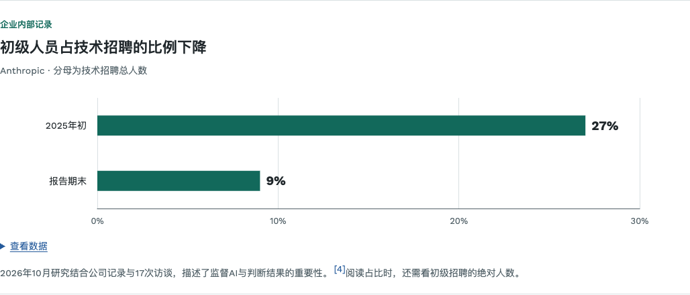

# Reader's Seat

> 从一个问题或已有材料出发，把复杂内容写明白。

[English](README.md) · [阅读案例报告](https://bobbyyue.github.io/reader-seat/reports/ai-and-work.zh.html) · [安装](#安装)

[](SKILL.md)
[](LICENSE)
[](https://github.com/BobbyYue/reader-seat/actions/workflows/validate.yml)

AI 写了很多，读完却还是不知道：结论是什么，依据在哪里，跟自己有什么关系。Reader's Seat 围绕这些读者问题组织完整文档。它既能根据一个问题查资料、写文章，也能整理你已经有的材料，不用编出来的事实填补信息缺口。

## 案例：AI 会怎样影响互联网公司的岗位？

你从事研发、产品、数据或运营工作，经常看到“AI 将替代岗位”的说法。你需要先分清哪些变化已经发生、哪些还只是预测，再判断自己应该学什么、调整什么。

**输入：一个调查问题，不需要先准备一篇文章。**

```text
AI 的发展是否会替代人类工作？已有的工作岗位会怎样受到 AI 的影响，
尤其是当前互联网公司的岗位？请包含正在发生的变化，以及预估的未来长期变化。
根据当前已有的权威调查和研究，使用 Reader's Seat 生成一份调查报告。
用中文输出为 HTML。
```

**产出：一份可以查证来源的完整调查报告。**

截图展示报告中的一张数据图。三张图分别呈现招聘占比、任务耗时和岗位预测，数字旁保留口径与来源。打开完整报告，还能查看六类岗位的影响分析与行动建议。

<a href="https://bobbyyue.github.io/reader-seat/reports/ai-and-work.zh.html"></a>

**[打开中文报告 →](https://bobbyyue.github.io/reader-seat/reports/ai-and-work.zh.html)** · [HTML 文件](docs/reports/ai-and-work.zh.html) · [英文报告](https://bobbyyue.github.io/reader-seat/reports/ai-and-work.en.html)

读者可以从报告中得到：

- **能直观看懂的数据：**用三张图分别展示招聘结构、任务耗时及其不确定范围、全球岗位预测，保持不同研究口径的区别。
- **与自己工作有关的分析：**研发、数据分析、产品、设计与内容、运营与营销、客服六类岗位，哪些任务可能变化。
- **可以继续判断的依据：**已经观察到的变化与长期情景分开写，保留来源，并给出可以在自己工作中验证的问题。

<sub>使用 Reader's Seat 0.36 起草，并根据用户反馈修改；图表版更新于 2026 年 10 月 23 日，沿用 10 月 22 日核对的九项一手来源。岗位映射为本文综合分析。这是一份经过编辑的案例，完整审阅尚有未通过项，见[生成与验证说明](docs/reports/example-notes.md#中文)。</sub>

## 安装

### 让 Agent 安装

把下面的指令发给能够安装 skill 的 Agent：

```text
从 https://github.com/BobbyYue/reader-seat 安装 Reader's Seat。
使用当前 Agent 支持的 skill 安装方式，文件夹名称保持为 reader-seat，
然后确认当前 Agent 能加载说明、运行 Python 检查，并支持隔离审阅流程。
缺少支持时请说明，不要宣称已经完整验证。已有同名安装时不要直接覆盖，先询问我。
```

### 手动 Git Clone

把仓库克隆到当前 Agent 使用的 skill 目录：

```bash
git clone https://github.com/BobbyYue/reader-seat.git /path/to/your-agent/skills/reader-seat
```

然后新建一个 Agent 会话，或让 Agent 显式加载 `reader-seat/SKILL.md`。不同 Agent 的 skill 发现方式不同。

完整检查后交付还需要兼容的审阅结果接入方式，加载说明不等于已经接通。具体要求见[运行环境说明](references/writing-execution.md)。

## 能生成哪些文档

| 你提供 | 得到的完整文档 |
| --- | --- |
| 一个问题、目标读者，以及可查询的可靠来源 | **调查报告**：证据、不同解释、不确定性与实际影响 |
| 周报、里程碑计划、会议记录、问题清单 | **项目进展报告**：当前结论、进度、阻塞、待决策事项和下一步 |
| 指标定义、查询结果、图表、方法说明 | **数据分析报告**：结论与幅度、支持证据、数据限制、其他解释和下一步验证 |
| 业务需求、技术约束、候选架构、性能测试 | **技术决策文档**：决策、方案比较、取舍、实施影响、回滚和未解决风险 |

它也适用于新闻和行业资料、产品文档、项目复盘、绩效总结、SOP、运行手册和帮助文档。

## 怎么使用

说明材料、读者和文档需要完成的任务。例如：

```text
使用 Reader's Seat，把这些周报、里程碑计划、会议记录和问题清单
整理成一份给管理层阅读的完整项目进展报告。
让当前结论、进度风险、支持证据、待决策事项和下一步容易找到；
材料里没有的信息保持未知，不要自行补全。
```

项目进展、数据分析和技术路线的完整写法见[提示词示例](examples/quick-start.md)。

## 它会守住什么

- **原意不变：**保留事实、数字、定义、负责人、承诺和不确定性。
- **判断有据：**结论能够对应到证据、适用范围和其他合理解释。
- **降低阅读成本：**关键信息必须可获取、可找到、可理解、可使用；标题、结构和视觉元素服务于这条阅读路径，而不是装饰。
- **表达具体：**需要说明价值的标题、章节名和开场句直接写清对象和有依据的结果，不用方法名或空泛价值词代替。
- **开头信息完整：**先明确这位读者必须知道什么，再检查只读标题或开头的人能否复述这些答案。原文已知但遗漏的信息需要补齐，原文没有的信息保持未知。
- **解释足够：**总结要保留理解主要观点所需的理由、证据和关系，不能只剩一组准确的标题；用户明确只要提纲时，仍然简短输出。
- **独立复核：**完整文档需分别通过无背景理解、文字可读性、来源可靠性以及结构与视觉障碍四项隔离校验。
- **输出符合场景：**默认使用原材料的主要语言生成自包含 HTML；用户指定时可以改为飞书、Word、Markdown 等格式。
- **交付边界明确：**生成前锁定语言、格式和发布权限；校验未通过或缺少回执时不交付。

未经明确授权，Reader's Seat 不会发布、覆盖或发送内容。它面向完整文档，也支持从一个问题开始调研写作；不用于短消息润色或没有依据的内容扩写。

<details>
<summary><strong>0.38.0 更新与历史升级说明</strong></summary>

### 删掉没有帮助读者的免责和兜底

0.38.0 在现有审读中加入[防御性表达检查](references/defensive-expression.md)：分别统计候选表达与确认多余的问题，比较同样准确的直接说法，保留有用的范围限定和不确定性。缺失、过期或未解决的检查记录会阻止正式交付。升级时重新生成第4版上下文审读记录，审读角色与轮次不变；上方报告案例保持原样。

### 让检查结果对应当前任务

0.37.0 会核对实际证据文件与调用方的当前任务，再返回检查过的内容；新增[平台接入入口](references/host-integration.md)，修复第三轮带说明草稿的出口，并保留公开版已有的来源识别修复。平台仍须主动接入，不会自动获得全局拦截。原有上下文审读也会区分写作指令与读者真正需要的信息。判断校准工具依据预先固定的参考集统计错误和遗漏运行，不认证内容质量。

### 把表达检查放进写前、写中和写后

0.36.0 会检查文章是否直接给出答案、更直接的说法是否保留原意，以及反复纠偏是否增加了整篇文章的阅读负担。这些检查分别进入写作计划、每个完整草稿单元和独立可读性审阅。有实际用途的警告、禁止事项和负面研究结果仍然保留。详见[直接表达规则](references/direct-expression.md)。

升级后需重新生成相关计划和审阅记录，表达检查字段及第 5 版读者价值记录仍为必需。0.35.1 的来源识别和审阅格式修复继续保留。0.37.0 已处理 0.36.0 记录的第三轮草稿出口限制，但尚未完成全面的盲读回放覆盖与真实第三方界面验收，详见[版本说明](CHANGELOG.md)。上方报告案例沿用此前发布的版本，不作为本轮的新验收结果。

### 当前流程

0.34.0 将写作阶段、实际隔离审阅结果和最终交付绑定到同一版本，并检查上下文是否帮助读者、观点是否归属于正确的来源。接入流程会拦截缺失或过期的证据，但不保证模型判断永远正确，也不会自动控制宿主中的所有输出。详见[版本说明](CHANGELOG.md)、[写作流程](references/writing-lifecycle.md)和[执行与接入](references/writing-execution.md)。

0.35 精简审阅记录的传输、复用输入未变的计算结果，并让有依赖的检查及时开始。0.35.1 另修复了制作本案例时发现的来源误判：附加语言信息不再阻止同一份来源通过检查；来源正文或路径变化仍会被拦截。

### 升级至 0.30.0

先选择读者需要的证据、关键限制和未解问题，再组织文字。已有审阅会说明修改消除了什么误解或阅读负担；没有具体收益就保留原文。[完整段落案例](references/writing-composition-examples.md)和[技巧对应案例](references/writing-craft-cases.md)只在拿不准时读取，不作为当前文档的事实来源。沿用第 2 版审阅字段、原有审阅角色和轮次，不新增文风评分或单独的审稿流程。

普通交付改用新的[检查后交付入口](references/checked-delivery.md)：重新调用已有验证，拦截缺失或过期的证据，直接返回被检查的内容。第三轮未通过仍以明确标注问题的草稿交付。使用 `--output` 可避免完整编码文档占用模型上下文。这个本地入口不会自动接入运行应用，也不替代原生局部修改和线上发布验证；程序测试通过不代表每次写作判断都正确。

### 之前版本的流程变化

总结前先区分：读者只需知道有哪些主题，还是需要理解观点及其理由。写完后，通过独立读者的实际复述检查解释是否足够。不设最低字数、不强制凑例子，也不增加审阅轮次。见[过度压缩反例](references/badcases/overcompressed-summary.md)。

旧的文档生成计划需补充 `depth` 和各项答案的 `kind`，审阅记录需重新生成有原文和读者复述依据的 `depth_fit`。旧版独立答案检查仍可读取，但不能替代新版完整文档流程。

在已有审阅中检查：细节是否有依据，段落是否推进理解，句子是否读得顺，作者的语气是否保留。检查需引用具体文字，不增加审阅轮次或禁用词表。审阅记录升级为第 2 版，旧记录需重新生成；清楚的原文、有用的例子和影响判断的条件仍应保留。见[写法对照案例](references/writing-craft.md)。

0.24.1 新增结合上下文的表达审查：指出原句、读者影响和最小修改办法。保留清楚的专业表达，不因审查者个人偏好反复重写，复用已有审查角色和轮次上限。

完整产物初始化时需提供有来源依据的读者必答信息计划。旧审阅记录若缺少对应的理解证据，需重新生成后才能用于已验证交付。限定范围的原生文字修改也必须在写入后回读并检查排版，写入前通过不等于完成。详见[版本说明](CHANGELOG.md)和[必答信息流程](references/required-reader-answers.md)。

</details>

<details>
<summary><strong>仓库结构、校验和许可证</strong></summary>

| 文件夹 | 提供的功能 |
| --- | --- |
| `.github/` | 在每次代码推送和合并请求时自动检查仓库。 |
| `agents/` | 帮助支持的 Agent 识别并展示 Reader's Seat。 |
| `assets/` | 提供自包含 HTML 模板、本地字体以及图表和流程图运行时。 |
| `config/` | 定义文档场景、模块加载方式、Agent 适配设置和可校验的 skill 约束。 |
| `evals/` | 提供固定的触发、行为和跨 Agent 测试案例及评判标准。 |
| `examples/` | 提供可以直接改写使用的常见文档提示词。 |
| `docs/` | 托管可以通过 GitHub Pages 直接阅读的完整 HTML 案例。 |
| `references/` | 提供按场景、格式、标题、证据和视觉需要选择的详细规则。 |
| `scripts/` | 校验 skill、选择模块、创建 HTML 报告骨架并运行评测。 |
| `tests/` | 验证语言、格式、授权、来源完整性和交付回执约束。 |

校验安装：

```bash
python3 /path/to/reader-seat/scripts/validate_skill.py
```

更新安装：

```bash
git -C /path/to/reader-seat pull
```

第三方字体和可视化运行时的来源与许可证见 [Third-Party Notices](assets/html/THIRD_PARTY_NOTICES.md)。

</details>
